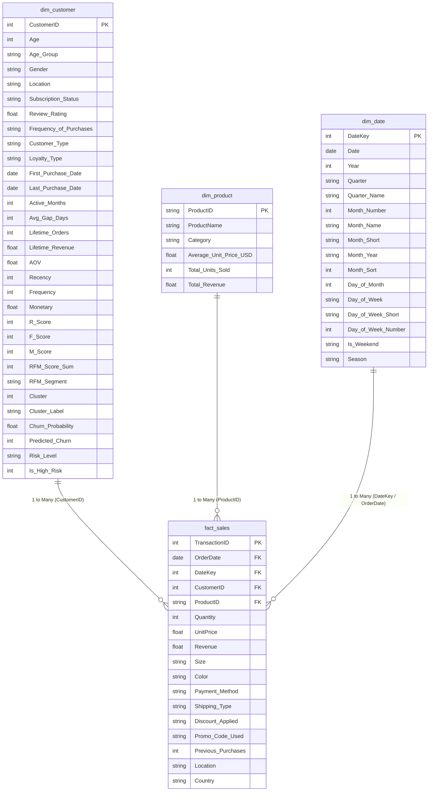

# Power BI Data Model Specification (Star Schema)

**Project Title:** E-Commerce Customer Behaviour Analysis and Customer Segmentation Using Python, Machine Learning and Power BI  
**Artifact:** Data Model Specification (`powerbi/model.md`)  
**Architecture:** Kimball Dimensional Star Schema  
**Target Platform:** Power BI Desktop  

---

## 1. Dimensional Architecture Overview

The Power BI data model is designed according to Kimball star schema principles. It isolates analytical measurements and transactional facts into a central **Fact Table** (`fact_sales`) and surrounds it with clean, denormalized **Dimension Tables** (`dim_customer`, `dim_product`, and `dim_date`).

This star schema delivers optimal in-memory VertiPaq compression, eliminates circular relationship paths, and ensures predictable, high-speed DAX evaluation.

---

## 2. Table Schemas & Key Definitions

### 2.1 Fact Table: `fact_sales` (`fact_sales.csv`)
- **Granularity:** One row per individual retail sales transaction ($N = 3,900$ rows).
- **Primary Key:** `TransactionID`
- **Foreign Keys:**
  - `CustomerID` $\rightarrow$ References `dim_customer[CustomerID]`
  - `ProductID` $\rightarrow$ References `dim_product[ProductID]`
  - `DateKey` $\rightarrow$ References `dim_date[DateKey]` (or `OrderDate` $\rightarrow$ `dim_date[Date]`)

| Column Name | Data Type | Role | Description / Domain |
| :--- | :--- | :--- | :--- |
| `TransactionID` | Integer | Primary Key | Unique surrogate identifier for the sales transaction (1 to 3,900). |
| `OrderDate` | Date | Foreign Key | Transaction date formatted as `YYYY-MM-DD`. |
| `DateKey` | Integer | Foreign Key | Integer date key formatted as `YYYYMMDD` (e.g., 20230115). |
| `CustomerID` | Integer | Foreign Key | Customer identifier joining to `dim_customer`. |
| `ProductID` | String | Foreign Key | Standard product identifier joining to `dim_product` (e.g., `P01` to `P25`). |
| `Quantity` | Integer | Fact Measure | Number of units purchased in the order (1 unit). |
| `UnitPrice` | Decimal/Currency | Fact Attribute | Selling price per unit in USD ($20.00 to $100.00). |
| `Revenue` | Decimal/Currency | Fact Measure | Total order transaction amount in USD (`Quantity * UnitPrice`). |
| `Size` | String | Degenerate Dim | Item size selected (`S`, `M`, `L`, `XL`). |
| `Color` | String | Degenerate Dim | Color variation selected (25 distinct colors). |
| `Payment_Method` | String | Dimension | Method used: Credit Card, PayPal, Cash, Bank Transfer, Venmo, Debit Card. |
| `Shipping_Type` | String | Dimension | Fulfillment speed: Express, Free Shipping, 2-Day, Standard, Next Day Air, Store Pickup. |
| `Discount_Applied` | String | Dimension | `Yes` / `No` promotional discount flag. |
| `Promo_Code_Used` | String | Dimension | `Yes` / `No` voucher redemption flag. |
| `Previous_Purchases`| Integer | Fact Attribute | Prior transactions completed by this customer at time of order. |
| `Location` | String | Dimension | US State where transaction took place. |
| `Country` | String | Dimension | Country origin (`United States`). |

---

### 2.2 Dimension Table: `dim_customer` (`dim_customer.csv`)
- **Granularity:** One row per unique customer ($N = 3,900$ rows).
- **Primary Key:** `CustomerID`
- **Enrichment:** Includes lifetime transactional value, demographic segments, RFM scores, K-Means cluster labels, and machine learning churn probabilities.

| Column Name | Data Type | Description & Category |
| :--- | :--- | :--- |
| `CustomerID` | Integer | **Primary Key**: Unique customer number (1 to 3,900). |
| `Age` | Integer | Customer chronological age (18 to 70). |
| `Age_Group` | String | Demographics: `18-25`, `26-35`, `36-50`, `51-65`, `66+`. |
| `Gender` | String | Demographics: `Male`, `Female`. |
| `Location` | String | Geographic territory: 50 US States. |
| `Subscription_Status`| String | Loyalty membership: `Yes`, `No`. |
| `Review_Rating` | Decimal | Product satisfaction score (1.0 to 5.0). |
| `Frequency_of_Purchases`| String | Stated purchasing cadence: Weekly, Bi-Weekly, Monthly, Quarterly, Annually. |
| `Customer_Type` | String | Behavioral cohort: `Returning Customer` ($\ge 10$ orders), `New Customer` ($< 10$ orders). |
| `Loyalty_Type` | String | Detailed cohort: `Returning Established (>=10 orders)`, `New / Early-Stage (<10 orders)`. |
| `First_Purchase_Date` | Date | Date of earliest customer interaction (`YYYY-MM-DD`). |
| `Last_Purchase_Date` | Date | Date of most recent purchase (`YYYY-MM-DD`). |
| `Active_Months` | Integer | Total relationship tenure in calendar months. |
| `Avg_Gap_Days` | Integer | Average expected days between purchase events. |
| `Lifetime_Orders` | Integer | Total historical orders completed across relationship lifetime. |
| `Lifetime_Revenue` | Decimal/Currency | Total cumulative historical spend in USD. |
| `AOV` | Decimal/Currency | Historical Average Order Value (`Lifetime_Revenue / Lifetime_Orders`). |
| `Recency` | Integer | RFM Metric: Days elapsed since latest transaction. |
| `Frequency` | Integer | RFM Metric: Lifetime purchase count. |
| `Monetary` | Decimal/Currency | RFM Metric: Total cumulative dollar spend. |
| `R_Score` | Integer | RFM Quintile: Recency score (1 to 5; 5 = Most Recent). |
| `F_Score` | Integer | RFM Quintile: Frequency score (1 to 5; 5 = Most Frequent). |
| `M_Score` | Integer | RFM Quintile: Monetary score (1 to 5; 5 = Highest Spend). |
| `RFM_Score_Sum` | Integer | Composite RFM score ($R + F + M$; range: 3 to 15). |
| `RFM_Segment` | String | Heuristic Segment: Champions, Loyal, Potential Loyalist, At Risk, Hibernating / Lost. |
| `Cluster` | Integer | K-Means Cluster index (0, 1, 2, 3). |
| `Cluster_Label` | String | Machine Learning Cluster: `High-Value Active`, `High-Value Inactive`, `Medium-Value`, `Low-Value`. |
| `Churn_Probability` | Decimal | ML Predicted Churn Probability ($0.0000$ to $1.0000$). |
| `Predicted_Churn` | Integer | ML Binary Output (1 = Churned, 0 = Retained). |
| `Risk_Level` | String | Churn Tier: `Low Risk (Active)`, `Medium Risk`, `High Risk (Churning)`. |
| `Is_High_Risk` | Integer | Binary flag for high-risk churn filtering (1 = High Risk, 0 = Other). |

---

### 2.3 Dimension Table: `dim_product` (`dim_product.csv`)
- **Granularity:** One row per retail product item ($N = 25$ unique products).
- **Primary Key:** `ProductID`

| Column Name | Data Type | Description |
| :--- | :--- | :--- |
| `ProductID` | String | **Primary Key**: Standardized code (`P01` to `P25`). |
| `ProductName` | String | Product commercial item name (e.g., Blouse, Jeans, Backpack). |
| `Category` | String | Merchandise department: `Clothing`, `Accessories`, `Footwear`, `Outerwear`. |
| `Average_Unit_Price_USD`| Decimal/Currency | Catalog benchmark average selling price. |
| `Total_Units_Sold` | Integer | Total units sold across historical sample. |
| `Total_Revenue` | Decimal/Currency | Aggregate commercial revenue generated by product. |

---

### 2.4 Dimension Table: `dim_date` (`dim_date.csv`)
- **Granularity:** One row per calendar day ($N = 730$ days spanning 2022-01-01 to 2023-12-31).
- **Primary Key:** `DateKey` (or `Date`)

| Column Name | Data Type | Description & Power BI Role |
| :--- | :--- | :--- |
| `DateKey` | Integer | **Primary Key**: Integer date formatted as `YYYYMMDD`. |
| `Date` | Date | Calendar date (`YYYY-MM-DD`). |
| `Year` | Integer | Calendar year (`2022`, `2023`). |
| `Quarter` | String | Fiscal quarter (`Q1`, `Q2`, `Q3`, `Q4`). |
| `Quarter_Name` | String | Display quarter label (`Q1 2023`). |
| `Month_Number` | Integer | Month index (1 to 12). |
| `Month_Name` | String | Full month name (`January`, `February`). |
| `Month_Short` | String | Abbreviated month (`Jan`, `Feb`). |
| `Month_Year` | String | Display month-year (`Jan 2023`). *Sort by `Month_Sort`.* |
| `Month_Sort` | Integer | Numeric sort column (`202301`, `202304`). |
| `Day_of_Month` | Integer | Day number (1 to 31). |
| `Day_of_Week` | String | Day name (`Monday`, `Tuesday`). *Sort by `Day_of_Week_Number`.* |
| `Day_of_Week_Short`| String | Abbreviated day (`Mon`, `Tue`). |
| `Day_of_Week_Number`| Integer | Day index (1 = Monday ... 7 = Sunday). |
| `Is_Weekend` | String | `Weekend` (Sat/Sun) vs `Weekday` (Mon-Fri). |
| `Season` | String | Meteorological season: `Winter`, `Spring`, `Summer`, `Fall`. |

---

## 3. Relationships Specification

All relationships in the model are strictly **One-to-Many ($1 : *$)** with **Single Direction** cross-filtering (Dimension filters Fact):

| From Dimension (1) | Primary Key | To Fact (*) | Foreign Key | Cardinality | Cross Filter Direction | Security Filter |
| :--- | :--- | :--- | :--- | :---: | :---: | :---: |
| `dim_customer` | `CustomerID` | `fact_sales` | `CustomerID` | $1 : *$ | Single (`dim_customer` filters `fact_sales`) | None |
| `dim_product` | `ProductID` | `fact_sales` | `ProductID` | $1 : *$ | Single (`dim_product` filters `fact_sales`) | None |
| `dim_date` | `DateKey` | `fact_sales` | `DateKey` | $1 : *$ | Single (`dim_date` filters `fact_sales`) | None |

> [!IMPORTANT]
> - Do **NOT** enable Bi-directional cross-filtering. Bi-directional relationships degrade VertiPaq engine performance and introduce contextual ambiguity in measure evaluation.
> - `dim_date` can join either on `DateKey` (integer) or `Date` (datetime). In our model, both keys match perfectly.

---

## 4. Power BI Modeling Best Practices Configuration

1. **Mark as Date Table**:
   - Right-click `dim_date` in the Data view $\rightarrow$ **Mark as Date Table** $\rightarrow$ Select `Date` as the date column.
2. **Sort by Column Configurations**:
   - Select `dim_date[Month_Year]` $\rightarrow$ Set **Sort by Column** to `dim_date[Month_Sort]`.
   - Select `dim_date[Month_Short]` $\rightarrow$ Set **Sort by Column** to `dim_date[Month_Number]`.
   - Select `dim_date[Day_of_Week]` $\rightarrow$ Set **Sort by Column** to `dim_date[Day_of_Week_Number]`.
   - Select `dim_customer[Age_Group]` $\rightarrow$ Set **Sort by Column** to `dim_customer[Age_Group]`.
3. **Data Summarization & Visibility**:
   - Hide foreign keys in `fact_sales` (`CustomerID`, `ProductID`, `DateKey`) from the Report View to guide users to dimensional attributes.
   - For all surrogate keys and ID fields (`CustomerID`, `TransactionID`, `DateKey`, `Cluster`, `R_Score`, etc.), set **Default Summarization** to `Do Not Summarize`.
4. **Data Formats**:
   - Currency: `fact_sales[UnitPrice]`, `fact_sales[Revenue]`, `dim_customer[Lifetime_Revenue]`, `dim_customer[AOV]` $\rightarrow$ Format as Currency (`$#,##0`).
   - Percentages: `dim_customer[Churn_Probability]` $\rightarrow$ Format as Percentage (`0.0%`).
   - Dates: `fact_sales[OrderDate]`, `dim_customer[First_Purchase_Date]`, `dim_customer[Last_Purchase_Date]`, `dim_date[Date]` $\rightarrow$ Format as `yyyy-mm-dd`.
